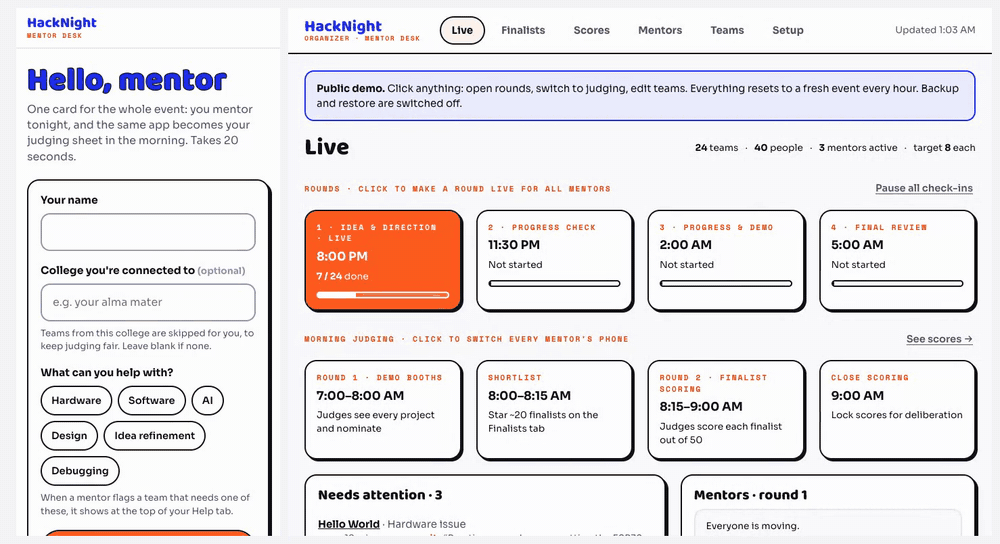

# Mentor Desk

**Run the mentoring and judging of an overnight hackathon from your mentors' phones.**

Mentors walk the floor checking in on every team through the night, raise and pick up help requests, and in the morning the same app becomes their judging sheet. Organizers watch it all live from a laptop: who has been checked, who needs help, which mentor needs a nudge, and how the finalists scored.

Built for, and run live at, **LAYOVER 2026**: an overnight student hackathon at TinkerSpace Calicut with 98 teams, 160 builders and 11 mentor-judges, who logged 303 check-ins and 143 score sheets in one night.

**[▶ Try the live demo](https://mentor-desk-demo.vercel.app)**: the mentor app on your phone, the organizer dashboard at [/admin](https://mentor-desk-demo.vercel.app/admin) (password `demo`). It's a seeded event that resets every hour, so click anything.



[](https://vercel.com/new/clone?repository-url=https%3A%2F%2Fgithub.com%2Fjasimcm%2Fmentor-desk&env=ADMIN_PASSWORD&envDescription=Password%20for%20the%20organizer%20dashboard%20at%20%2Fadmin&project-name=mentor-desk)

---

## What it does

**For mentors (phone, `/`)**
- **Check-ins through the night.** Up to four short rounds (idea → progress → demo → final review). Each mentor gets their own shuffled list of teams still due, so mentors spread out instead of crowding the same tables.
- **Fair by default.** A mentor is never sent back to a team they've already checked, teams from a mentor's college are skipped, and anyone can mark "I know this team". Later mentors see what a team *said* earlier, never other mentors' ratings.
- **Team locks.** Start a check-in and the team is locked to you, so two mentors never fill in the same team at once.
- **Help on demand.** Flag a team that needs hardware, AI, design… help; mentors with that skill get an alert on their phone.
- **Follow-ups.** Go back to a team you helped and leave a note for everyone. Continuity without breaking the fresh-eyes rule (it isn't a check-in and adds no points).
- **Top-two picks.** Each mentor picks their two favourite teams from any team they checked during the night.
- **Morning judging.** Optional demo booths that steer judges toward teams they *haven't* seen (with an optional suggested number of nominations), then scoring of the finalists against your rubric (out of 50 by default).

**For organizers (laptop, `/admin`)**
- **Live:** open rounds, skip one, switch morning stages; a "needs attention" list (open help requests, off-track teams, unclear plans, teams away twice); which mentor is on which team and who needs a nudge.
- **Finalists:** every team ranked by mentor signal (pool votes, final ratings, top-two picks), with booth nominations split into fresh and repeat, and *booth discoveries* flagged; star the shortlist.
- **Scores:** averages per finalist and per criterion, a judge-normalised score, abstentions; each judge's sheet with delete.
- **Mentors:** per-mentor analysis: check-ins, time per check-in, gaps, time spent helping, notes length, how generous or strict they judged.
- **Teams:** add, edit, hide or delete teams (with table numbers); edit, move or delete any mentor's check-in.
- **Setup:** import participants (CSV/XLSX), invite link, practice data, reset, CSV exports, **backup and restore**.

Everything event-specific (the name, colours, rounds, every question, help types, the judging rubric, schedule) lives in **one config file**. See [docs/CONFIG.md](docs/CONFIG.md).

**New here?** [docs/HOW-IT-WORKS.md](docs/HOW-IT-WORKS.md) explains why it's useful and how every part works: rounds, locks, fair rotation, help routing, the shortlist signal, scoring and normalisation, and the architecture.

## Quick start

```bash
git clone https://github.com/jasimcm/mentor-desk.git
cd mentor-desk
npm install
npm run dev            # http://localhost:3000  ·  organizer: /admin (password: admin)
```

Locally it runs on an embedded Postgres (PGlite) in `.pglite/`, so there's nothing else to install. Delete that folder to start over. Open `/admin` → Setup → **Load practice data** to try it with dummy teams, then open `/` on your phone.

```bash
npm test               # full event walk-through on a throwaway database
```

## Make it yours

Edit **`public/event.config.js`** to point at a preset, or copy one:

| Preset | What it is |
|---|---|
| [`presets/hackathon.js`](public/presets/hackathon.js) | Generic overnight hackathon (the default) |
| [`presets/layover.js`](public/presets/layover.js) | LAYOVER 2026: travel theme, floor-aware table numbers. A worked example of a themed event |

Change the event name, colours, round times, every check-in question, the help types and the judging rubric. [docs/CONFIG.md](docs/CONFIG.md) lists every field and the handful of question ids the engine relies on.

## Deploy

Mentor Desk is static pages plus one serverless function, and needs Postgres.

**Vercel + Neon (what LAYOVER ran on)**
1. Click **Deploy with Vercel** above (or `vercel link`), and set `ADMIN_PASSWORD`.
2. Add a Postgres database: Vercel → Storage → Neon (or any Postgres) so `DATABASE_URL` is set.
3. Optional: `MENTOR_CODE`, an event code mentors type when they join.
4. Deploy. Tables are created on the first request.

**Anywhere else:** any Node 18+ host works. `api/rpc.js` is a standard `(req, res)` handler and `public/` is static; `dev.mjs` shows how to wire them together with plain `node:http`. Set `DATABASE_URL` to any Postgres.

| Variable | Required | What it does |
|---|---|---|
| `ADMIN_PASSWORD` | yes (in production) | Password for `/admin`. Without it the dashboard is locked. |
| `DATABASE_URL` | yes (in production) | Postgres connection string. Without it, PGlite is used (local only). |
| `MENTOR_CODE` | no | Event code mentors must enter to join. |
| `DEMO_MODE` | no | `1` for a public demo: data resets to a seeded event every hour, backup and restore are off. |
| `DEMO_RESET_MINUTES` | no | Reset interval in demo mode (default 60). |

## Running an event

1. **Before:** set up the config; Setup → import teams (one row per person: team no., team name, name, college); set the organizer phone; copy the invite message to mentors.
2. **Practice:** load practice data, let mentors try it, then **Reset event data**.
3. **Back up** before every big step (Setup → Download backup). Backups hold mentors' sign-in tokens, so keep them private.
4. **Night:** Live → click a round to make it live on every phone. Watch *Needs attention* and the mentors table.
5. **Morning:** switch to Demo booths (if your event uses them), star the shortlist on Finalists once booths close, open finalist scoring, close scoring.

## How it's built

No framework and no build step: static pages, one serverless function, Postgres.

```
public/
  index.html, admin.html     the two apps
  event.config.js            → points at your preset
  presets/                   event setups (hackathon, layover)
  js/mentor.js, js/admin.js  mentor app, organizer dashboard (hash routers)
  js/shared.js               rpc(), config, forms, rubric, helpers
api/rpc.js                   the only endpoint: POST /api/rpc {action, args}
lib/actions.js               all logic: public, mentor and organizer (o.*) actions
lib/db.js                    schema, sql(), transaction(); pg in production, PGlite locally
dev.mjs                      local server
test/e2e.mjs                 end-to-end test
```

Mentors get a random token on join (`x-token`); organizer actions need `x-admin: <ADMIN_PASSWORD>`. Live updates are polling (15–30 s), which is plenty for a hackathon floor with patchy Wi-Fi.

## The story

Mentor Desk was built in a week and hardened during the event itself. [docs/building-it-live.md](docs/building-it-live.md) tells the story of every bug we hit on the night and what each one taught us.

## Contributing

Issues and pull requests are welcome. See [CONTRIBUTING.md](CONTRIBUTING.md). Found a security problem? See [SECURITY.md](SECURITY.md).

## License

[MIT](LICENSE). Built by [TinkerHub](https://tinkerhub.org) folks for LAYOVER 2026, and shared so any hackathon can use it.
