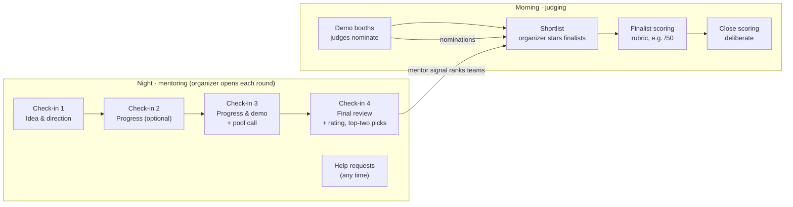
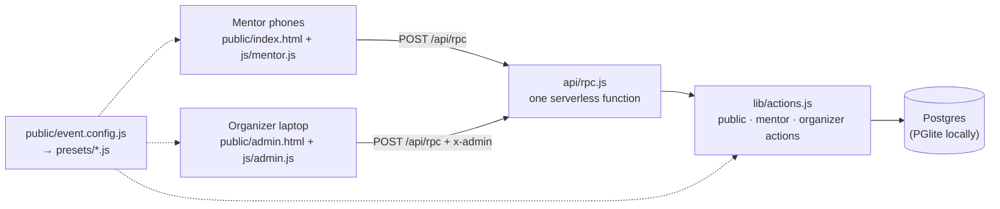

# How Mentor Desk works

This document explains **why Mentor Desk exists**, **how an event flows through it**, and **how each part works inside**. It's for organizers deciding whether to use it, and for developers who want to change it.

- [Why it's useful](#why-its-useful)
- [The idea in one picture](#the-idea-in-one-picture)
- [The night: check-ins](#the-night-check-ins)
- [Help requests](#help-requests)
- [The organizer's view](#the-organizers-view)
- [From the night to a shortlist](#from-the-night-to-a-shortlist)
- [The morning: judging](#the-morning-judging)
- [Fixing things on the night](#fixing-things-on-the-night)
- [Architecture](#architecture)
- [Data model](#data-model)
- [Reliability and safety](#reliability-and-safety)
- [Extending it](#extending-it)

---

## Why it's useful

An overnight hackathon has a hard people problem. A hundred teams build for twelve hours; ten or so mentors are meant to help all of them, notice who's stuck, and then judge fairly in the morning. Usually that runs on a spreadsheet, a WhatsApp group and memory. What goes wrong is predictable:

| Without a system | With Mentor Desk |
|---|---|
| Mentors cluster around the loud, visible teams; quiet teams go all night without a visit. | Every mentor gets their **own shuffled list of teams still due**, so they fan out. Organizers see exactly which teams no one has reached yet. |
| Two mentors check the same team minutes apart; another team gets nobody. | Starting a check-in **locks the team**. Others see 🔒 and the mentor's name. |
| The same mentor keeps visiting the same favourite teams. | The app **won't send a mentor back** to a team they've already checked, so every team gets several independent views. |
| "Team 42 needs help with their Arduino" gets lost in a group chat. | Help requests are **routed to mentors with that skill**, alert their phones, and turn red for organizers if nobody picks them up in 15 minutes. |
| In the morning, judges have no idea who to look at among 100 teams. | Night notes become a **ranked must-see list**: a shortlist built from several mentors' independent calls, not one person's memory. |
| Judges know some teams personally; one generous judge skews the result. | **Conflicts are declared and enforced**, the average is over judges who actually scored, and a **normalised score** shows whether generous or strict judges tilted anything. |
| Afterwards nobody knows what happened. | Every check-in, help request and score is recorded: **CSV exports, a per-mentor analysis, and full backups**. |

It was built for and run live at **LAYOVER 2026**: 98 teams, 160 builders and 11 mentor-judges, who logged 303 check-ins overnight and 143 score sheets in the morning. Every team was visited, and no team was missed.

### Design principles

1. **Mentors are on their feet, tired, holding a phone.** The mentor app has two tabs (Teams, Help) and one main button per screen. A check-in takes about a minute.
2. **Organizers need to see the whole room.** The dashboard is dense on purpose: what's happening now, who needs attention, which mentor needs a nudge.
3. **Night notes help; they don't judge.** Check-ins build the shortlist and help teams, but never count toward the judging marks, which are scored fresh in the morning.
4. **Fair by default.** Fresh eyes each round, declared conflicts, no rating anchoring (mentors see what a team *said* earlier, never other mentors' ratings).
5. **Boring technology.** Static pages, one serverless function, Postgres. No framework, no build step, nothing to break at 3 AM.

---

## The idea in one picture



The **same people** do both: mentors by night become judges by morning, in the same app. A mentor joins once and keeps one identity all event.

---

## The night: check-ins

### Rounds

There are four rounds. Each has its own short form, defined in the config. The organizer makes a round **live** from the Live tab, and every mentor's phone switches to it within about 15–20 seconds. Only one round is live at a time. Any round can be **skipped**: its card greys out and can't be opened by accident. The default preset folds round 2's questions into round 3, so skipping round 2 loses nothing.

### Who checks which team

When a mentor opens the app, the server works out the state of every team for that mentor in the live round:

| State | Meaning | Shown as |
|---|---|---|
| `due` | Not checked yet this round | **Due** (or "Away 9:12 PM" if someone found them absent) |
| `busy` | Another mentor has started it | 🔒 + their name; can't be opened |
| `done` | Checked this round | **Done** (· you) |
| `seen` | *This mentor* checked them in an earlier round | **You saw them**: leave them for fresh eyes |
| `conflict` | The mentor declared "I know this team", or a member is from the mentor's college | **Skip** |

The home screen shows the next **8 due teams** in an order that is **different for every mentor and stable for that mentor**. It's a hash of `mentorId:teamId` with an avalanche mix, so mentors naturally spread across the room instead of all walking to team #1. Teams already found away sink to the bottom, oldest first, so nobody keeps walking back to an empty table. Search covers team name, member names and table number.

"You: 7 of 10 teams" is a **fair share** (teams ÷ active mentors), not an assignment. Teams are shared; the round is done when every team is.

### Locks

Tapping **Start** takes a lock on that team for that round. The lock is what stops two mentors filling in the same team:

- The lock lasts **10 minutes**, but while the form is open the phone **renews it every 30 seconds** (and again when the screen wakes). So it never expires mid-form; it only lapses 10 minutes after a mentor walks away.
- **Cancel** releases it immediately. *Not at their spot* and *I know this team* release it too.
- If a mentor's phone slept long enough for someone else to take the team, their form says so ("Ben has this team now" / "Ben already submitted"), and their answers stay saved on the phone.
- The server accepts **one check-in per team per round**. A second submission is refused with the name of who submitted first.

### What later mentors see

At the top of each form, the mentor sees the **facts** earlier mentors recorded: what the team is building, the theme link, their goal, what they've built and what's blocking them. Which answers carry forward is set by `noteKeys` in the config. **Ratings are never shown**, so each round is an independent read.

The team page also shows a status line for every round ("✓ Check-in 1 · Asha, 9:12 PM", "● Check-in 3 · open now") and a list of every mentor who has been to the team.

### Follow-ups: continuity without losing fresh eyes

Mentors naturally want to go back to a team they helped: did the fix work? Repeat check-ins would undo the "fresh eyes" rule that makes the shortlist reliable, so instead a mentor who has checked a team can tap **Follow up with this team** and leave a short note ("sensor fixed, demo works end to end"). Follow-ups are visible to every mentor on the team page and to organizers in the team timeline and mentor analysis, but they are **not check-ins and add no points**.

At LAYOVER, fresh eyes held completely: 97 of 98 teams were seen by three different mentors and nobody needed "check anyway". Follow-ups keep that while giving mentors the continuity they asked for.

### Drafts and bad Wi-Fi

Answers are saved to the phone as they're typed, so a refresh, a dead battery or a lost connection doesn't lose a half-filled form. Every request retries up to 3 times with back-off (0.8 s, 1.6 s, 2.4 s) and shows a "Weak connection · retrying…" bar. Venue Wi-Fi at 3 AM is rarely good.

---

## Help requests

Any mentor can raise a help request for a team: *Technical blocker*, *Hardware issue*, *Idea unclear*… (the list is in the config). Each type can be routed to mentor **skills**: *Hardware issue* → mentors who said they can help with Hardware.

Help requests also come from forms automatically:
- Ticking a skill under "Do they need help?" in check-in 1 raises a request for that skill.
- Answering **On track? → No** in check-in 2 or 3 raises an **Off track** alert with the mentor's reason.

```mermaid
sequenceDiagram
  participant M1 as Mentor A
  participant S as Server
  participant M2 as Mentor B (Hardware)
  participant O as Organizer
  M1->>S: raise "Hardware issue" for Team X
  M2->>S: ping (every 15 s)
  S-->>M2: newest open request matching your skills
  Note over M2: phone vibrates, badge pulses,<br/>banner "Help needed · Team X · Table 14"
  M2->>S: take (I'll go help)
  M2->>S: resolve
  Note over O: open > 15 min with nobody on it → turns red;<br/>organizer can Assign someone
```

Requests show the team's table so whoever picks them up knows where to walk. On iPhones, which can't vibrate from a web page, the badge and banner carry the alert.

---

## The organizer's view

`/admin` is protected by `ADMIN_PASSWORD`.

**Live** (refreshes every 10 s)
- Round cards with progress ("88 / 106 done"); click to make a round live, or skip one.
- Morning stage cards that switch every mentor's phone to judging.
- **Needs attention**: open help requests (red after 15 min unclaimed), off-track teams, teams with an unclear plan at check-in 1, and teams found away twice. Each has Assign / Resolve.
- **Mentors · now**: what each mentor is doing, with a nudge flag if they've been on one team 15+ minutes, have no check-in 10+ minutes into the round, or have been quiet for 20+ minutes.
- **Unchecked teams** for the live round, with tables.

**Mentors** (refreshes every 30 s): an analysis per mentor:
- check-ins by round, and how many different teams;
- average time per check-in (Start → Submit) and the typical gap between check-ins (gaps over 45 min are treated as breaks);
- time spent helping;
- check-ins started but never submitted;
- characters written per check-in (a rough measure of note quality);
- how often they sent teams to the final pool.

Click a mentor for every team they visited, with times.

**Teams**: add, edit, hide or delete teams; each team's timeline across all rounds, with every mentor's answers.

**Setup**: import participants from CSV/XLSX (one row per person, grouped into teams), round names and times, invite link and event code, mentor list (pause / remove), practice data, reset, exports, backup and restore.

---

## From the night to a shortlist

The **Finalists** tab ranks every team by *mentor signal*, built from several mentors' independent calls:

| Signal | Where it comes from | Points |
|---|---|---|
| Pool call | Check-in 3 "Send to the final judging pool?" | Yes +1, Maybe +0.5 |
| Final rating | Check-in 4 "Recommend for the finalist round?" 1–4 | 4 → +2, 3 → +1 |
| Top-two picks | Each mentor picks their two favourite teams from **any** team they checked during the night | +1 per pick |

Ties are broken by picks, then final rating, then demo-readiness. The board also shows strengths tags, demo-readiness, how many mentors saw the team, and **booth nominations** from the morning, split into **fresh** (from a judge who never checked the team overnight) and **repeat**. Teams with low night points but two or more fresh nominations are tagged **Booth discovery**: the teams that came together late or demo better than they describe. A dashed line marks the shortlist cut (e.g. top 20). Starring a finalist while booths are still open asks for confirmation.

The organizer **stars** the finalists. The star is the final say; the points are a guide. Only starred teams appear in finalist scoring.

---

## The morning: judging

1. **Demo booths** (optional: `judging.booths` in the config). Judges walk the floor science-fair style. Their booth screen is built to counter familiarity bias: their own nominations on top, then **Must-see · new to you** (teams strong in the night's notes that this judge hasn't checked), then **every other team they haven't seen**, each with its table and a one-line idea, and finally the teams they checked overnight, folded away. Nominating is optional; a suggested number ("suggested 3, optional") nudges every judge to contribute. Their favourites already count through top-two picks, so the screen asks them to nominate teams that surprise them.

   *Why:* at LAYOVER, 85% of booth nominations went to teams the judge had already checked overnight (29% would be expected by chance), partly because the booth screen offered nothing to browse. Booths only add information if judges look beyond the teams they already know.
2. **Shortlist.** The organizer stars the finalists on the Finalists tab.
3. **Finalist scoring.** Judges see only the finalists. For each criterion in the rubric they tap one of six levels (0 to the maximum, in fifths), add an optional note, and save. They can change their score until scoring closes.
4. **Close scoring.** Scores lock for deliberation.

### Fairness in scoring

- **Conflicts.** A judge connected to a team (declared "I know this team", or a member from their college) can't nominate or score it. If they declared the conflict *after* scoring, their sheet is **left out** automatically and shown struck through, with `counted = no` in the CSV.
- **Abstaining never hurts a team.** A team's average is over the judges who actually scored it, not over every judge.
- **Exact ranking.** Teams rank on the exact average (shown to two decimals), with ties broken by the first two criteria. Rounding never decides who wins.
- **Normalised score.** Next to the average, each team gets a *normalised* score. Each judge's totals are turned into z-scores against that judge's own mean and spread, averaged per team, and put back on the rubric's scale. If one judge gives everyone 45 and another gives everyone 30, this evens them out. It matters most when judges scored different sets of teams. The ranking still uses the plain average, but the normalised rank is shown wherever it differs, so the panel can see whether judge style changed anything.

The panel always makes the final call. Scores are a guide for deliberation.

---

## Fixing things on the night

Real events are messy. Organizers can, from `/admin`:

- **Edit** any check-in's answers (marked "Edited by an organizer").
- **Move** a check-in to the right team when a mentor filed it under the wrong one. It moves in one transaction, along with the help requests it created, and the original team becomes due again.
- **Delete** a check-in (the team becomes due again), an away mark, a help request, or one judge's score sheet.
- **Hide** a team from mentors (no-shows, withdrawn teams). It disappears from every mentor list and count, but its data stays.
- **Pause or remove** a mentor, and **lock or unlock** top-two picks.

---

## Architecture



- **No framework, no build step.** The browser loads plain ES modules. `js/shared.js` holds the config, the forms, the rubric, the `rpc()` helper and small utilities used by both apps.
- **One endpoint.** Every call is `POST /api/rpc` with `{ action, args }`. `api/rpc.js` routes it:
  - *public* actions (`boot`, `join`) need nothing;
  - *mentor* actions need the mentor's token in `x-token`;
  - *organizer* actions are prefixed `o.` and need `x-admin: <ADMIN_PASSWORD>`.
- **One config, read everywhere.** The same `event.config.js` is imported by the server and by both browser apps, so questions, labels and the rubric can never drift apart.
- **Hash routing.** `#/team/12`, `#/form/12/3`, `#/help`, `#/scores`… Pages render as template strings, and polling re-renders the parts that change.
- **Polling, not sockets.** Mentor home every 20 s, help check every 15 s, lock keep-alive every 30 s; organizer Live every 10 s, Scores 15 s, Finalists 20 s, Mentors 30 s. Polls pause when a tab is hidden. That's plenty for people walking between tables, and it works through flaky Wi-Fi and serverless hosting with no extra infrastructure.
- **Two database drivers.** In production `lib/db.js` uses `pg` against `DATABASE_URL`. Locally it uses PGlite, an embedded Postgres in a folder, so `npm run dev` needs nothing installed. The schema is created on the first request.

### Identity

There are no passwords for mentors. **Join** creates a mentor record with a random token, which the phone keeps in `localStorage`. An optional `MENTOR_CODE` stops strangers who find the link from joining. Mentor history is also matched by name, so someone who re-joins on a new phone keeps their "You saw them" history.

---

## Data model

| Table | One row per | Key fields |
|---|---|---|
| `teams` | team | code, name, type (solo/duo/team), members (JSON), table_no, hidden |
| `mentors` | mentor | token, name, college, skills, active |
| `config` | the event (one row) | live round, stage, round names and times, skipped rounds, picks lock |
| `checkins` | team × round | mentor, answers (JSON), started_at, at (submitted), edited_at |
| `locks` | team × round | mentor, started_at, expires_at |
| `visits` | "not at their spot" | team, round, mentor, at |
| `conflicts` | mentor × team | "I know this team" |
| `flags` | help request | type, skill, note, source (manual / check-in), raised_by, taken_by/at, resolved_at |
| `picks` | mentor | first and second team, with why |
| `nominations` | judge × team | booth nomination |
| `scores` | judge × team | marks (JSON, per rubric criterion), total, note |
| `shortlist` | starred finalist | |

Answers and marks are JSON, so changing the questions or the rubric needs no database migration.

---

## Reliability and safety

- **Backups.** Setup → *Download backup* saves every table to one JSON file. *Restore* first downloads a backup of the current data, then replaces everything **in a single transaction**: if anything fails, nothing changes. Take one before each big step of the night.
- **Concurrency.** Locks use an atomic upsert that only succeeds if the lock is free, expired or already yours. Check-ins have a `(team, round)` primary key. Moving a check-in runs in a transaction.
- **Crash safety.** The `pg` pool has an error handler, so a dropped idle connection can't take the function down, and failed transaction connections are discarded rather than reused.
- **Practice mode.** *Load practice data* adds dummy teams (codes `D-xx`) and shows mentors a "Practice run" banner. *Reset event data* removes all of it, keeping mentors and real teams.
- **Privacy.** Backups contain mentors' tokens and participant data, so keep them private. See [SECURITY.md](../SECURITY.md).

---

## Extending it

- **Change the event**: edit a preset. See [CONFIG.md](CONFIG.md). Run `npm test` afterwards; it walks a whole event through your config.
- **Add a question that triggers something**: forms are data, but features key off question ids (see the table in CONFIG.md). Add logic in `lib/actions.js` where `submit()` handles `help` and `onTrack`.
- **Add a column**: append `ALTER TABLE … ADD COLUMN IF NOT EXISTS …` at the end of the schema in `lib/db.js`, nullable, so existing databases and older backups keep working.
- **Host elsewhere**: `api/rpc.js` is a plain `(req, res)` handler and `public/` is static. `dev.mjs` shows the whole wiring in about 30 lines of `node:http`.

For the story of how all this was hardened on the night itself, bug by bug, read [building-it-live.md](building-it-live.md).
